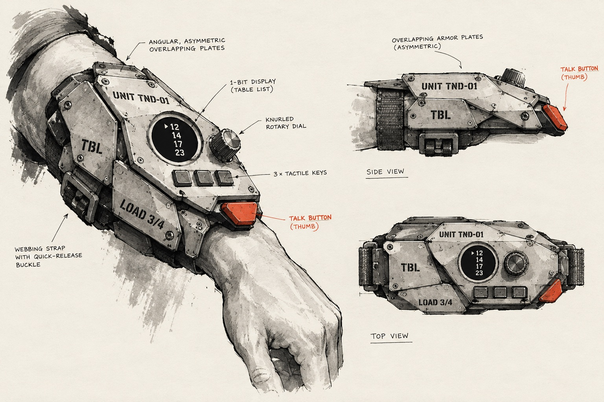
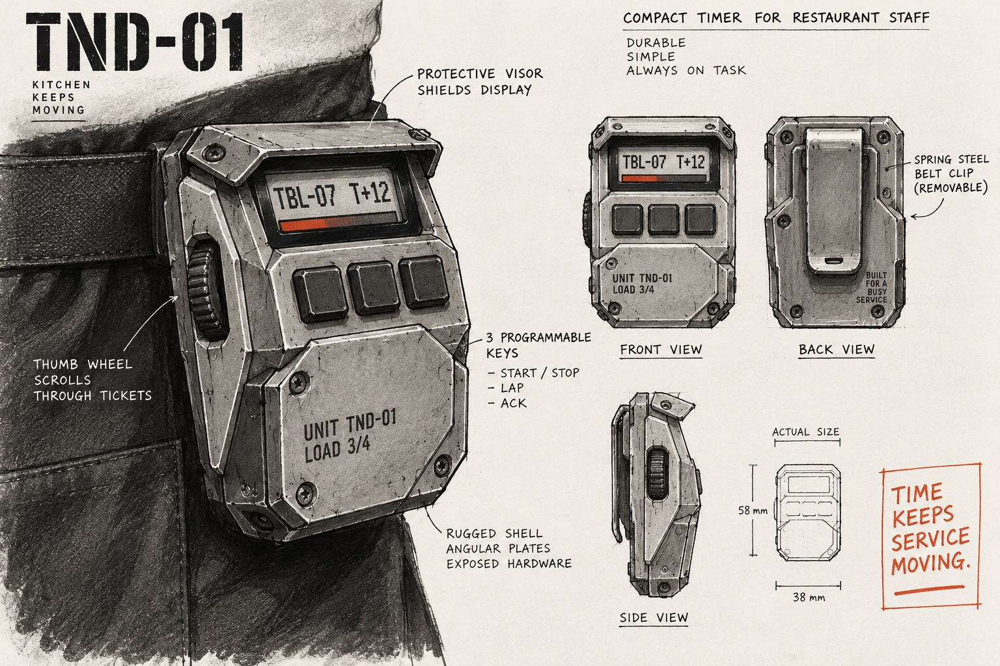
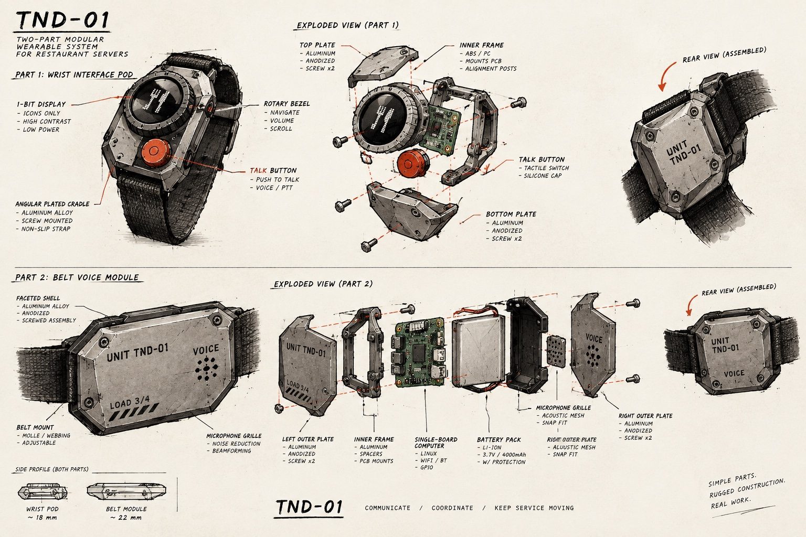

# Enclosure concept sketches

Round 1, 2026-11-13. 3 sketches test the [Ink Industrial design language](design-language.md) on 3 mounting options from the [device page](../20-device/device.md#mounting).

Limit: an image model drew the sketches. Dimensions, materials and battery capacity in the callouts are invented by the model `[?]`. They are not specifications.

The screen text and key labels in the sketches (`TBL-07 T+12`, `START / STOP`, `LAP`, `LOAD 3/4`) are replaced by the [UX audit](ux-principles.md) and the [design review](design-review-rev-0-1.md). The current enclosure is [rev 0.2](../40-hardware/40-hardware.md).

## A. Forearm bracer

- Plated shell on the outer forearm, round display, knurled dial, 3 keys, accent talk button at the thumb.
- Strength: screen and controls are in view with no hand movement.
- Risk: the largest part; it can catch on trays and plates. The restaurant may not allow it.

## B. Belt module

- Slab on the apron belt, screen tilted up under a visor, thumb wheel on the side, 3 keys, spring clip.
- Strength: the smallest and the easiest to hide. Closest to the stage 0 board size.
- Risk: the server must look down; no talk button in this sketch. The visor over the screen hides the top line from above; rev 0.2 has no visor.

## C. Modular split

- Wrist pod (round display, rotary bezel, talk button) and a belt voice module (single-board computer, battery, microphone grille).
- Strength: matches the 2-unit [architecture](../20-device/device.md#architecture): interface unit and voice unit.
- Risk: 2 devices to charge and to connect.

## Open points

1. Artemy chose direction B `[A]` 2026-11-13. Direction B is built as the parametric enclosure in `tender-hardware`, rev 0.1 and rev 0.2.
2. Check the size of rev 0.2 (62 × 62 mm) on the belt with a paper mockup. Sketch B shows 58 × 38 mm `[?]`.

[Parent](10-concept.md)
